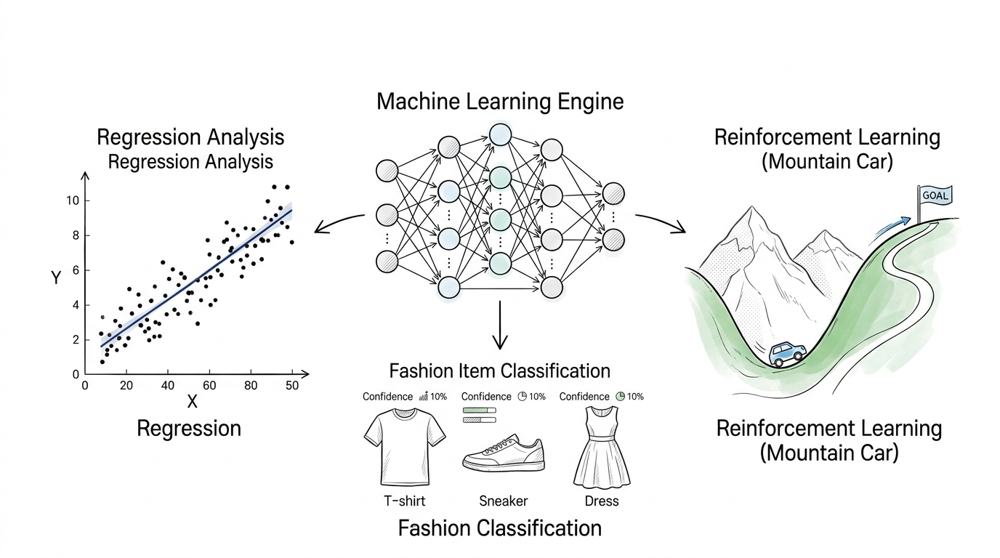

<p align="center">
  
</p>

# Neural Networks and Deep Learning (NNDL)

[](https://pytorch.org/)
[](https://gymlibrary.dev/)
[](https://optuna.org/)
[](https://opensource.org/licenses/MIT)

A curated collection of deep learning architectures, empirical experiments, and analytical reports developed for the **Neural Networks and Deep Learning** (NNDL) course. The project spans three major paradigms: **Supervised Learning** (Regression & CNN Classification), **Generative Modeling** (Autoencoders, VAEs, GANs), and **Deep Reinforcement Learning** (DQN).

---

## 📂 Repository Structure

```text
7_NNDL/
├── assets/
│   └── cover.jpg                                # Repository banner image
│
├── hw1_supervised_learning/
│   ├── hw1_regression_classification.ipynb      # Regression & FashionMNIST classification
│   └── hw1_presentation.pdf                     # Presentation slides and empirical findings
│
├── hw2_generative_models/
│   ├── hw2_autoencoders_vae_gan.ipynb           # Autoencoders, VAEs, and GANs
│   └── hw2_report.pdf                           # Architectural analysis & latent space report
│
├── hw3_reinforcement_learning/
│   ├── hw3_dqn_cartpole_mountaincar.ipynb        # Deep Q-Networks (CartPole & MountainCar)
│   └── hw3_report.pdf                           # Reinforcement learning experiments & results
│
├── .gitignore
├── requirements.txt                             # Python dependencies
└── README.md
```

---

## 🔬 Project Modules & Key Topics

### 1. [Supervised Learning: Regression & Classification](./hw1_supervised_learning/)
* **1D Non-Linear Function Approximation:**
  * Trained multi-layer perceptrons (MLP) to recover an underlying continuous signal from noisy samples.
  * Inspected internal representation dynamics: weight distribution histograms, layer-wise activation functions, and empirical receptive fields.
  * Compared hyperparameter tuning strategies: manual random search, **Skorch** grid search, and **Optuna** (TPE sampler).
* **FashionMNIST Multi-Class Classification:**
  * Architectural comparison between Deep Linear Networks (MLP) and Convolutional Neural Networks (CNN).
  * Impact of regularization: dropout, $L_2$ weight decay, and image augmentation transforms (rotations, random cropping, affine jitter).
  * Training pipeline abstractions: custom PyTorch training loops, `torchbearer`, and `skorch`.

---

### 2. [Generative Modeling & Latent Representations](./hw2_generative_models/)
* **Standard Autoencoders (AE):**
  * Compression, reconstruction loss, and dimensionality reduction on FashionMNIST.
  * Latent space visualization and manifold geometry using **t-SNE** and **PCA**.
  * Transfer learning / Semi-supervised classification: fine-tuning pre-trained encoder representations on labeled subsets.
* **Variational Autoencoders (VAE):**
  * Probabilistic latent modeling using the reparameterization trick and ELBO optimization ($\mathcal{L}_{rec} + D_{KL}$).
  * Continuous 2D manifold navigation, smooth interpolation, and synthetic sample generation.
  * Investigated $\beta$-VAE configurations for latent factor disentanglement.
* **Generative Adversarial Networks (GANs):**
  * Deep convolutional Generator and Discriminator trained via min-max adversarial loss.
  * Monitored discriminator/generator loss convergence, mode coverage, and animated generation progress across training epochs.

---

### 3. [Deep Reinforcement Learning (DQN)](./hw3_reinforcement_learning/)
* **CartPole-v1 (State-based DQN):**
  * Implemented Deep Q-Networks using **Experience Replay** (`collections.deque`) and target network stabilization.
  * Policy exploration strategies: $\epsilon$-greedy decay schedules vs. Softmax / Boltzmann exploration across varied temperature curves.
  * Reward shaping: evaluated agent behavior under customized positional penalties, angular deviation weights, and early failure penalties.
* **CartPole-v1 (Vision / Image-based DQN):**
  * End-to-end visual reinforcement learning: fed raw environment screen frames into a Convolutional DQN.
* **MountainCar-v0:**
  * Overcoming sparse rewards and continuous non-linear dynamics using Q-learning.

---

## 🛠️ Tech Stack & Dependencies

* **Core Framework:** [PyTorch](https://pytorch.org/), [Torchvision](https://pytorch.org/vision/)
* **Reinforcement Learning:** [Gym](https://www.gymlibrary.dev/)
* **Hyperparameter Optimization:** [Optuna](https://optuna.org/), [Skorch](https://skorch.readthedocs.io/)
* **Machine Learning & Analysis:** Scikit-Learn, SciPy, NumPy, Pandas
* **Visualization:** Matplotlib, Seaborn, Bokeh, Plotly, ImageIO, Torchsummary

---

## 🚀 Getting Started

### 1. Clone the Repository
```bash
git clone https://github.com/francescozambelli/7_NNDL.git
cd 7_NNDL
```

### 2. Set Up Environment & Install Dependencies
```bash
# Create and activate a virtual environment (optional but recommended)
python3 -m venv venv
source venv/bin/activate

# Install dependencies
pip install -r requirements.txt
```

> [!TIP]
> **Viewing Notebooks on GitHub:**
> Some notebooks contain high-resolution plots, t-SNE projections, and training animations (files are ~2MB–6MB). If GitHub's web interface times out when loading them, you can paste the notebook URL into [nbviewer.org](https://nbviewer.org/) or consult the included PDF presentations/reports located alongside each notebook.

---

## 👤 Author
**Francesco Zambelli**
* GitHub: [@francescozambelli](https://github.com/francescozambelli)
